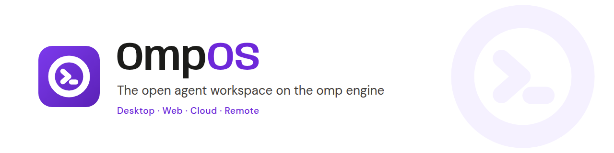
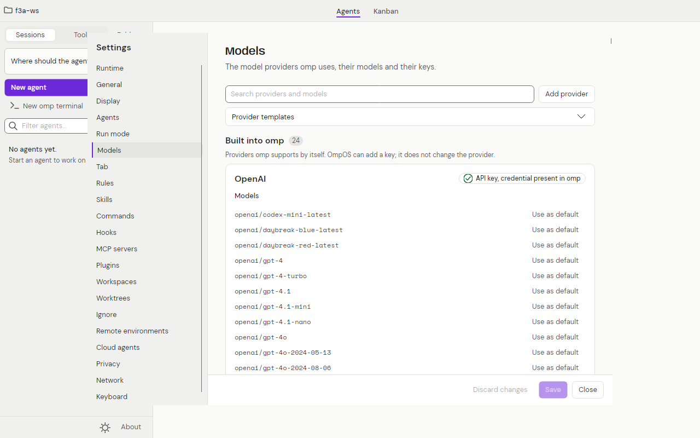

**OmpOS is an agent workspace for desktop, web and Android on the omp engine, with the Cursor feature set under an open licence.**

[](LICENSE)
[](https://github.com/swcstudiospace/OmpOS/actions/workflows/ci.yml)
[](global.json)
[](https://avaloniaui.net/)
[Docs: docs/README.md](docs/README.md)

# OmpOS

OmpOS is a Cursor-class workspace for coding agents on the **omp** engine: a desktop app, a web app, cloud agents and remote environments, under an open licence (AGPL-3.0-or-later). You start several agents, watch them work, steer them while they run and review their file changes. Every omp process OmpOS starts runs with four plugins: Ultrathink, Substrate, Swarm and GSD-Core. OmpOS has no model of its own: you bring a provider and a key, chosen from a catalogue of 103 European, US, Chinese, global and local providers and coding plans.

Be clear about maturity: this is pre-1.0 software. The desktop app is built and verified on Linux without a model turn; **no live model turn has been run** since a bounded capture in Phase 11, nothing was run on Windows, macOS or Android, and nothing is deployed to Railway. The tables below say what is Built, Partial or Blocked.

## Screenshots


*Web app, Demo build: a simulated engine produces the thread; no model is called.*


*Web app, Demo build.*


*Desktop app on Linux (the real omp engine; no model turn).*



*Desktop Settings window on Linux.*

## What is built

Status words: **Built** = implemented, reachable from a head and covered by tests the gate runs. **Partial** = part is built or wired; the audit names the missing piece. **Blocked** = needs something outside the repository. The row-by-row truth is the [Cursor parity audit of 2026-10-28](docs/quality/cursor-parity-audit-2026-10-28.md).

| Feature | Status | Note |
|---|---|---|
| Desktop app: Agents window, thread, composer, Kanban, omp terminals, Changes bar, live steering, Settings | Built | Linux only; no model turn |
| Four plugins loop on every omp process | Built | Checked against the real omp without a model turn |
| White-and-Purple brand, Light default | Built | Owner sign-off of the logo is open |
| AGPL-3.0-or-later licence, notices, `GET /source` offer | Built | Licence of two submodules is open |
| Web app: shell, rail, thread, composer, Changes, Kanban, Settings, Demo | Partial | Unit-tested components; Demo has a simulated engine; no public deployment |
| Model provider catalogue (103 rows) and coding plans | Partial | No credential used; 49 rows partly verified |
| Slash commands (92 Cursor tokens) | Partial | Every token has a handler or a stated reason |
| Hooks (`hooks.json`, 21 events) | Partial | Not run against a live omp |
| MCP servers, run modes, checkpoints, worktrees, mentions, ignore files | Partial | Built and unit-tested; head wiring tracked in the audit |
| Remote environments over ssh | Partial | Never run against a real host |
| Multi-repo workspaces | Partial | Core built |
| Cloud agents on Railway | Partial | Control plane and worker against fakes; no deploy |
| GitBook documentation site | Blocked | Published after the owner connects GitBook |
| Cursor accounts, teams, billing | Omitted | No accounts by design |

## Quick start

Requirements: `bash`, `curl`, `git` and `python3`; `omp` on `PATH` (the engine); the plugin submodules (`git clone --recurse-submodules`, or `git submodule update --init --recursive`; `plugins/agent-substrate` is private and its plugin reports Unavailable without access); optional `podman` for the local sandbox. .NET is not a prerequisite: `./bootstrap.sh` installs the SDK pinned in `global.json` into `~/.dotnet`.

**Desktop (Linux):**

```sh
export DOTNET_ROOT=$HOME/.dotnet PATH=$HOME/.dotnet:$PATH DOTNET_NOLOGO=1 DOTNET_CLI_TELEMETRY_OPTOUT=1
git submodule update --init --recursive
dotnet run --project apps/OmpOS.Native
```

The workspace root is the current directory. The app starts no omp process until you send a prompt or open an omp terminal. Press Ctrl+, for Settings and add a provider key on the Models page.

**Web Demo (no backend):**

```sh
scripts/vercel/build-demo.sh
scripts/web-demo/serve-demo.sh      # http://127.0.0.1:5190/
```

**Web with a local API:** see [docs/runbooks/web-demo.md](docs/runbooks/web-demo.md). **Everything (build, test, format, web smoke):** `./bootstrap.sh`, see [docs/runbooks/local-dev.md](docs/runbooks/local-dev.md).

The desktop head reads these variables (`apps/OmpOS.Native/Agents/AgentLoopEnvironment.cs`):

| Variable | What it does |
|---|---|
| `OMPOS_STATE_DIR` | Root of all application state (session catalogue, settings, provider key store). Default `$XDG_DATA_HOME/OmpOS`, else `~/.local/share/OmpOS`. |
| `OMPOS_PLUGINS_ROOT` | The plugins directory. Default `plugins/` next to the repository root. |
| `OMPOS_SUBSTRATE_URL` | Address of the Substrate server (https, or http on a loopback host). Unset means it is not used. |
| `OMPOS_SUBSTRATE_TOKEN_ENV` | The NAME of the variable the Substrate token is read from (default `SUBSTRATE_TOKEN_OMP`). The token itself is never logged or stored. |

## Model providers

The Settings > Models page lists **103 providers, aggregators, coding plans and local runtimes**: Europe 20 (17 model APIs, 1 aggregator, 2 coding plans), United States and Canada 25, China 41, Global 8 and 9 local runtimes. Each row names the vendor page it was read on, the base URL, how the key is sent and a verification status (50 verified, 49 partial, 4 unverified). Keys are never stored in the catalogue: omp keeps them. See [docs/guides/providers-guide.md](docs/guides/providers-guide.md) and the generated [docs/reference/providers.md](docs/reference/providers.md).

## Documentation

The documentation is in [docs/README.md](docs/README.md): guides for the desktop and web apps, concepts, settings, providers, hooks, remote environments, cloud agents, the HTTP API, decisions and the parity audit. It is laid out for GitBook's GitHub Git Sync and is published after the owner connects GitBook, see [docs/runbooks/gitbook-publish.md](docs/runbooks/gitbook-publish.md); until a live URL is confirmed, read it here. `bash scripts/ci/check-docs.sh` checks its structure.

## Support, contributing and security

- Help and questions: [SUPPORT.md](SUPPORT.md). Best effort; no service-level agreement.
- Contributing: [CONTRIBUTING.md](CONTRIBUTING.md) (branches, commit subjects, formatting, lock files, DCO sign-off); [CODE_OF_CONDUCT.md](CODE_OF_CONDUCT.md).
- Security: report privately as [SECURITY.md](SECURITY.md) describes, never in a public issue.
- Changes: [CHANGELOG.md](CHANGELOG.md).

## Project layout

| Path | Contents |
| ---- | -------- |
| `apps/` | Heads: `OmpOS.Native` (Avalonia desktop), `OmpOS.Web` (Blazor WebAssembly), `OmpOS.Android` (Avalonia) |
| `services/` | `OmpOS.Api` (ASP.NET Core API and cloud control plane), `OmpOS.AgentWorker` (cloud agent worker) |
| `src/` | Libraries: `Contracts`, `Parser`, `Harness.*` (Acp, AgentLoop, Remote, Mcp, Providers, Workspace, Worktrees, Terminal, ...), `Sandbox`, `Sessions`, `GenUi`, `Presentation`, `Native.Views`, `UI`, ... |
| `plugins/` | The four omp plugins: submodules `claude-ultrathink`, `agent-swarm`, `agent-substrate` and the tracked `gsd-core-omp`; see [docs/plugins.md](docs/plugins.md) |
| `tests/` | Per-project suites, contract fixtures and `ArchitectureTests` |
| `docs/` | The documentation (GitBook root), ADRs, runbooks, audits, plans and recorded evidence |
| `assets/brand/` | Logo set, banner and social preview; see [docs/brand.md](docs/brand.md) |
| `scripts/` | CI and docs checks (`scripts/ci/`, `scripts/docs/`), web smoke, Vercel and brand helpers |
| `deploy/` | Containerfiles and `compose.yaml` for podman-compose |
| `.planning/` | Roadmap, requirements, state and per-phase records |
| `OmpOS.slnx`, `OmpOS.Linux.slnf` | Solution, and the filter for Linux and CI (everything except the Android head) |
| `Directory.Build.props`, `Directory.Packages.props`, `global.json`, `.editorconfig`, `bootstrap.sh` | Build policy, central package versions, pinned SDK, style rules, the one-command gate |

## What is verified where

| Surface | Verifier | Scope |
| ------- | -------- | ----- |
| Linux (CI pool) | `ci.yml` job `build-test` | Everything in `OmpOS.Linux.slnf`, the plugin node tests, the secret scan and the web smoke |
| Linux dev box | `./bootstrap.sh` | The same scope |
| Linux (CI pool) | `ci.yml` job `android` | `apps/OmpOS.Android`: restore and `-warnaserror` build; no device or emulator |
| Windows, macOS, iOS | none | Not built or run: they need a Windows 11 runner and the Mac channel |

Live tests against the real omp (no model turn) are opt-in: `OMPOS_LIVE_OMP=1`, trait `Category=Live`.

## License

OmpOS is licensed under the GNU Affero General Public License, version 3 or (at your option) any later version (SPDX: `AGPL-3.0-or-later`). Copyright (C) 2026 SWC Studio. See [LICENSE](LICENSE) for the full text and [NOTICE](NOTICE) for the notice and third-party pointers; third-party licences are in [THIRD-PARTY-NOTICES.md](THIRD-PARTY-NOTICES.md).

Network use is distribution for this licence (AGPL section 13): if you run a modified OmpOS as a service that other people use over a network, you must offer those users the Corresponding Source of your version. OmpOS makes this easy: the API answers an anonymous `GET /source` with the licence, the source URL and the exact revision, and the web and desktop About pages link to the same source at <https://github.com/swcstudiospace/OmpOS>. Details for users and operators: [docs/licensing.md](docs/licensing.md).

Contributions are accepted under the same licence with a Developer Certificate of Origin sign-off (`git commit -s`); see [CONTRIBUTING.md](CONTRIBUTING.md). The plugin submodules under `plugins/` and the omp engine are separate programs with their own terms.
