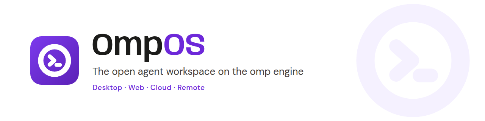

**Autonogrammer is an agent workspace for desktop, web and Android on the omp engine, with the Cursor feature set under an open licence.**

[](LICENSE)
[](https://github.com/swcstudiospace/OmpOS/actions/workflows/ci.yml)
[](global.json)
[](https://avaloniaui.net/)
[Docs: docs/README.md](docs/README.md)

# Autonogrammer

Autonogrammer is a Cursor-class workspace for coding agents on the **omp** engine: a desktop app, a web app, cloud agents and remote environments, under an open licence (AGPL-3.0-or-later). You start several agents, watch them work, steer them while they run and review their file changes. Every omp process Autonogrammer starts runs with four plugins: Ultrathink, Substrate, Swarm and GSD-Core. Autonogrammer has no model of its own: you bring a provider and a key, chosen from a catalogue of 103 European, US, Chinese, global and local providers and coding plans.

Be clear about maturity: this is pre-1.0 software. The desktop app is built and verified on Linux without a model turn; **no live model turn has been run** since a bounded capture in Phase 11, nothing was run on Windows, macOS or Android, and neither the API nor a cloud agent a user can start is deployed to Railway (a private staged worker is: see the Cloud agents row). The one public deployment is the web **Demo**, <https://ompos-web.vercel.app>: a static build whose engine is simulated in the browser (no backend, no model, no secret). The tables below say what is Built, Partial or Blocked.

## Screenshots

The six web screenshots are the **Demo build**: a simulated engine produces every thread, approval and diff; no model is called and no file exists. The two desktop screenshots are the **real app** on Linux under Xvfb with a sandbox profile, Light theme, no model turn. Method and the other captures: [web evidence](docs/runbooks/evidence/web-app-2026-10-28/README.md), [desktop evidence](docs/runbooks/evidence/desktop-app-2026-10-28/README.md).


*Web Demo, Light: the agent rail and a running thread. Scripted; the banner under the top bar says so.*


*Web Demo, Dark.*


*Web Demo, Changes bar of a completed agent. Keep and Undo change the in-memory state only; no file exists.*


*Web Demo, Kanban board; it scrolls sideways, so the later columns are off screen. The note says Substrate is unavailable in the Demo.*


*Web Demo, Settings > Models: the real catalogue of 103 provider rows (here China, coding plans); key entry is disabled in the Demo.*


*Web Demo at 390 px.*


*Desktop app on Linux (real omp installed, no model turn): a new session with the slash palette open. The banner says six pipeline stages are degraded because the plugin submodules were not checked out in the sandbox that was photographed.*


*Desktop Settings > Models on Linux: the 24 providers built into omp. It overlaps the main window because the capture ran without a window manager.*

## What is built

Status words: **Built** = implemented, reachable from a head and covered by tests the gate runs. **Partial** = part is built or wired; the audit names the missing piece. **Blocked** = needs something outside the repository. The row-by-row truth is the [Cursor parity audit of 2026-10-28](docs/quality/cursor-parity-audit-2026-10-28.md), re-graded against the final tree. Test counts on the final tree were recorded per project on 2026-10-28 (for example Presentation 2303, Native 2012 with 2 skipped, AgentLoop 1221, Api.IntegrationTests 1027); the full `./bootstrap.sh` gate result on the final commit is recorded separately in [docs/runbooks/evidence](docs/runbooks/evidence/).

| Feature | Status | Note |
|---|---|---|
| Desktop app: Agents window, thread, composer, Kanban, omp terminals, Changes bar, live steering, Settings (21 pages) | Built | Linux only; no model turn; [screenshots and defects found](docs/runbooks/evidence/desktop-app-2026-10-28/README.md) |
| Four plugins loop on every omp process | Built | Checked against the real omp without a model turn |
| White-and-Purple brand, Light default | Built | Owner sign-off of the logo is open |
| AGPL-3.0-or-later licence, notices, `GET /source` offer | Built | Licence of two submodules is open |
| Web Demo, deployed | Built | <https://ompos-web.vercel.app>; simulated engine; headless Chrome capture without console error or failed request; 68 axe runs, 0 violations |
| Web app: shell, rail, thread, composer, Changes, Kanban, Settings (18 pages) | Partial | Unit-tested; real Models page over `GET /providers`; Hooks and MCP pages read-only; no hosted API behind it; no image attach |
| Model provider catalogue (103 rows) and coding plans | Partial | omp accepts a `models.yml` with every route; no live credential used; 49 rows partly verified |
| Slash commands (92 Cursor tokens, 93 rows) | Partial | Built 36, Partial 24, Delegated 9, Unavailable 24; each has a handler or a stated reason |
| Built-in skills (10) | Partial | In the desktop palette and Skills page; ssh, container, API-hosted and web sessions carry none; no live turn |
| Hooks (`hooks.json`, 21 events) | Partial | Wired into desktop sessions and proven with fakes; no live omp ran a hook; cloud consent claim not yet minted |
| MCP servers (import, 13 presets), run modes, mentions, ignore files | Partial | Wired into the desktop head; unit and wiring tests; no live turn |
| Checkpoints and rewind, worktree commands, queue, custom modes, side chats, fork | Partial | Mounted in the desktop window; rewind restores files only; no live turn |
| Image attachments | Partial | Desktop composer to ACP image blocks; no live turn; model vision unknown; no web or Android attach |
| Automations | Partial | Desktop cron scheduler and page; API routes off by default; webhooks refused on the desktop |
| Remote environments over ssh | Partial | A live run through a loopback `sshd` with the real omp passed on Linux; no real network host; remote file explorer and terminal pane not wired |
| Containers (podman) and WSL | Partial | A live podman test passed on Linux (alpine); WSL never ran |
| Multi-repo workspaces | Partial | Workspace sets and `--add-dir` wired; no live run |
| Cloud agents on Railway | Partial | Control plane and desktop client against fakes; the worker image runs under podman with a real omp ([14 of 14 checks](docs/runbooks/evidence/cloud-worker-container-2026-10-28/README.md)); a staged private worker runs on Railway (health-checked, real `omp acp` answers `initialize` and `session/new` through its JWT bridge, no model turn; [evidence](docs/runbooks/evidence/railway-autonogrammer-worker-2026-10-28.md)); the API is not deployed (OD-03), no clone bootstrap |
| GitBook documentation site | Blocked | Published after the owner connects GitBook |
| Cursor accounts, teams, billing | Omitted | No accounts by design |

## Quick start

Requirements: `bash`, `curl`, `git` and `python3`; `omp` on `PATH` (the engine); the plugin submodules (`git clone --recurse-submodules`, or `git submodule update --init --recursive`; `plugins/agent-substrate` is private and its plugin reports Unavailable without access); optional `podman` for the local sandbox. .NET is not a prerequisite: `./bootstrap.sh` installs the SDK pinned in `global.json` into `~/.dotnet`.

**Desktop (Linux):**

```sh
export DOTNET_ROOT=$HOME/.dotnet PATH=$HOME/.dotnet:$PATH DOTNET_NOLOGO=1 DOTNET_CLI_TELEMETRY_OPTOUT=1
git submodule update --init --recursive
dotnet run --project apps/Autonogrammer.Native
```

The workspace root is the current directory. The app starts no omp process until you send a prompt or open an omp terminal. Press Ctrl+, for Settings and add a provider key on the Models page.

**Web Demo (no backend).** Open <https://ompos-web.vercel.app> (a simulated engine, no model), or build it yourself:

```sh
scripts/vercel/build-demo.sh
scripts/web-demo/serve-demo.sh      # http://127.0.0.1:5190/
```

**Web with a local API:** see [docs/runbooks/web-demo.md](docs/runbooks/web-demo.md). **Everything (build, test, format, web smoke):** `./bootstrap.sh`, see [docs/runbooks/local-dev.md](docs/runbooks/local-dev.md).

The desktop head reads these variables (`apps/Autonogrammer.Native/Agents/AgentLoopEnvironment.cs`):

| Variable | What it does |
|---|---|
| `AUTONOGRAMMER_STATE_DIR` | Root of all application state (session catalogue, settings, provider key store). Default `$XDG_DATA_HOME/Autonogrammer`, else `~/.local/share/Autonogrammer`. |
| `AUTONOGRAMMER_PLUGINS_ROOT` | The plugins directory. Default `plugins/` next to the repository root. |
| `AUTONOGRAMMER_SUBSTRATE_URL` | Address of the Substrate server (https, or http on a loopback host). Unset means it is not used. |
| `AUTONOGRAMMER_SUBSTRATE_TOKEN_ENV` | The NAME of the variable the Substrate token is read from (default `SUBSTRATE_TOKEN_OMP`). The token itself is never logged or stored. |

## Model providers

The Settings > Models page lists **103 providers, aggregators, coding plans and local runtimes**: Europe 20 (17 model APIs, 1 aggregator, 2 coding plans), United States and Canada 25, China 41, Global 8 and 9 local runtimes. Each row names the vendor page it was read on, the base URL, how the key is sent and a verification status (50 verified, 49 partial, 4 unverified). Keys are never stored in the catalogue: omp keeps them. See [docs/guides/providers-guide.md](docs/guides/providers-guide.md) and the generated [docs/reference/providers.md](docs/reference/providers.md).

## Documentation

The documentation is in [docs/README.md](docs/README.md): guides for the desktop and web apps, concepts, settings, providers, hooks, remote environments, cloud agents, the HTTP API, decisions and the parity audit. It is laid out for GitBook's GitHub Git Sync and is published after the owner connects GitBook, see [docs/runbooks/gitbook-publish.md](docs/runbooks/gitbook-publish.md); until a live URL is confirmed, read it here. `bash scripts/ci/check-docs.sh` checks its structure.

## Support, contributing and security

- Help and questions: [SUPPORT.md](SUPPORT.md). Best effort; no service-level agreement.
- Contributing: [CONTRIBUTING.md](CONTRIBUTING.md) (branches, commit subjects, formatting, lock files, DCO sign-off); [CODE_OF_CONDUCT.md](CODE_OF_CONDUCT.md).
- Security: report privately as [SECURITY.md](SECURITY.md) describes, never in a public issue.
- Changes: [CHANGELOG.md](CHANGELOG.md).

## Project layout

| Path | Contents |
| ---- | -------- |
| `apps/` | Heads: `Autonogrammer.Native` (Avalonia desktop), `Autonogrammer.Web` (Blazor WebAssembly), `Autonogrammer.Android` (Avalonia) |
| `services/` | `Autonogrammer.Api` (ASP.NET Core API and cloud control plane), `Autonogrammer.AgentWorker` (cloud agent worker) |
| `src/` | Libraries: `Contracts`, `Parser`, `Harness.*` (Acp, AgentLoop, Remote, Mcp, Providers, Workspace, Worktrees, Terminal, ...), `Sandbox`, `Sessions`, `GenUi`, `Presentation`, `Native.Views`, `UI`, ... |
| `plugins/` | The four omp plugins: submodules `claude-ultrathink`, `agent-swarm`, `agent-substrate` and the tracked `gsd-core-omp`; see [docs/plugins.md](docs/plugins.md) |
| `tests/` | Per-project suites, contract fixtures and `ArchitectureTests` |
| `docs/` | The documentation (GitBook root), ADRs, runbooks, audits, plans and recorded evidence |
| `assets/brand/` | Logo set, banner and social preview; see [docs/brand.md](docs/brand.md) |
| `scripts/` | CI and docs checks (`scripts/ci/`, `scripts/docs/`), web smoke, Vercel and brand helpers |
| `deploy/` | Containerfiles and `compose.yaml` for podman-compose |
| `.planning/` | Roadmap, requirements, state and per-phase records |
| `Autonogrammer.slnx`, `Autonogrammer.Linux.slnf` | Solution, and the filter for Linux and CI (everything except the Android head) |
| `Directory.Build.props`, `Directory.Packages.props`, `global.json`, `.editorconfig`, `bootstrap.sh` | Build policy, central package versions, pinned SDK, style rules, the one-command gate |

## What is verified where

| Surface | Verifier | Scope |
| ------- | -------- | ----- |
| Linux (CI pool) | `ci.yml` job `build-test` | Everything in `Autonogrammer.Linux.slnf`, the plugin node tests, the secret scan and the web smoke |
| Linux dev box | `./bootstrap.sh` | The same scope |
| Linux (CI pool) | `ci.yml` job `android` | `apps/Autonogrammer.Android`: restore and `-warnaserror` build; no device or emulator |
| Windows, macOS, iOS | none | Not built or run: they need a Windows 11 runner and the Mac channel |
| Linux (loopback, recorded 2026-10-28) | Opt-in live tests | A real `omp acp` through a real `sshd` ([evidence](docs/runbooks/evidence/remote-ssh-live-2026-10-28/README.md)); `podman exec` into an alpine container (`AUTONOGRAMMER_LIVE_PODMAN=1`); no model turn |
| Linux, headless Chrome (recorded 2026-10-28) | `scripts/web-demo/capture.mjs`, `scripts/web-smoke/smoke-demo.mjs` | The capture of the locally built Demo and of the live Demo URL: no console error, no failed request; the smoke: 68 axe runs, 0 violations (Wave 5 tree) |
| Linux, throwaway podman services (recorded 2026-10-28) | `scripts/test-services.sh` | Api.IntegrationTests 1027, Coordination 32 and Sessions.Postgres 58 passed on the final tree |

Live tests against the real omp (no model turn) are opt-in: `AUTONOGRAMMER_LIVE_OMP=1`, trait `Category=Live`. Nothing in this repository has been verified with a model turn or on Windows, macOS or Android; on Railway only the staged private worker has been exercised (health check and an `initialize` and `session/new` handshake, no model turn).

## License

Autonogrammer is licensed under the GNU Affero General Public License, version 3 or (at your option) any later version (SPDX: `AGPL-3.0-or-later`). Copyright (C) 2026 SWC Studio. See [LICENSE](LICENSE) for the full text and [NOTICE](NOTICE) for the notice and third-party pointers; third-party licences are in [THIRD-PARTY-NOTICES.md](THIRD-PARTY-NOTICES.md).

Network use is distribution for this licence (AGPL section 13): if you run a modified Autonogrammer as a service that other people use over a network, you must offer those users the Corresponding Source of your version. Autonogrammer makes this easy: the API answers an anonymous `GET /source` with the licence, the source URL and the exact revision, and the web and desktop About pages link to the same source at <https://github.com/swcstudiospace/OmpOS>. Details for users and operators: [docs/licensing.md](docs/licensing.md).

Contributions are accepted under the same licence with a Developer Certificate of Origin sign-off (`git commit -s`); see [CONTRIBUTING.md](CONTRIBUTING.md). The plugin submodules under `plugins/` and the omp engine are separate programs with their own terms.
