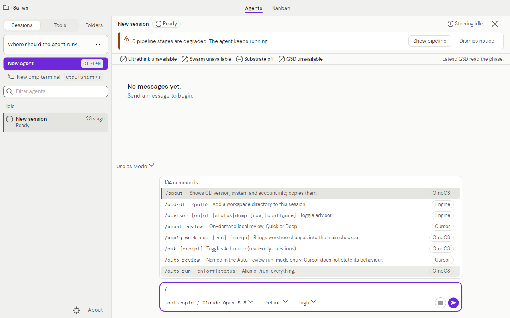

# OmpOS documentation

Status: Built (this page is the entry point; every feature page states its own status)

Last verified: 2026-10-28

Applies to: v0.15.0

OmpOS is a workspace for coding agents, aimed at the Cursor 3.27 feature set under an open licence (AGPL-3.0-or-later). Its engine is [omp](https://github.com/can1357/oh-my-pi): you open a **desktop app** or a **web app**, start several agents, watch them work, steer them while they run, review their file changes, and optionally run them in a git worktree, on another machine over `ssh`, or in the cloud. Every omp process OmpOS starts runs with four plugins: Ultrathink, Substrate, Swarm and GSD-Core.

These pages say only what is implemented. Where something is built but has not been exercised live (no model turn, no Windows, macOS or Android run, no API on Railway; only a staged private worker ran there) the page says so, and the [parity audit](quality/cursor-parity-audit-2026-10-28.md) lists every Cursor feature with its status. The two live proofs on Linux are a real `omp acp` through a loopback `sshd` and a `podman exec` test, both recorded 2026-10-28.

Try the web app without installing anything: the **Demo** at <https://ompos-web.vercel.app> is a static build with a simulated engine (no backend, no model, no secret).

*Screenshot of the Demo build: a simulated engine produces the thread; no model is called.*

*Screenshot of the real desktop app on Linux (Xvfb, sandbox profile, no model turn). The degraded-pipeline banner appears because the plugin submodules were not checked out in that sandbox.*

## Start here

| I want to | Read |
|---|---|
| Install and run OmpOS | [Getting started](guides/getting-started.md) |
| Use the desktop app | [Desktop app guide](guides/desktop-app-guide.md) |
| Use the web app, or see the Demo | [Web app guide](guides/web-app-guide.md) |
| Understand the ideas | [Concepts](guides/concepts.md), [Architecture](architecture.md), [Glossary](guides/glossary.md) |
| Pick a model provider and add a key | [Choose a model provider](guides/providers-guide.md) |
| Find a setting | [Settings guide](guides/settings-guide.md) |
| Fix a problem | [Troubleshooting and FAQ](guides/troubleshooting-and-faq.md) |
| See what is built and what is not | [Status and roadmap](guides/status-and-roadmap.md) |

## Features at a glance

| Feature | Status | Page |
|---|---|---|
| Agents window, thread, composer, Kanban, Changes bar, steering (desktop, Linux) | Built | [Desktop app guide](guides/desktop-app-guide.md) |
| Web Demo (deployed, simulated engine) | Built | [Web app guide](guides/web-app-guide.md), [Web head runbook](runbooks/web-demo.md) |
| Web app against an API | Partial | [Web app guide](guides/web-app-guide.md) |
| Model providers and coding plans (103 rows) | Partial | [Choose a model provider](guides/providers-guide.md) |
| Slash commands (93 rows: Built 36, Partial 24, Delegated 9, Unavailable 24) | Partial | [Slash commands](reference/slash-commands.md) |
| Built-in skills (10) | Partial | [Built-in skills](reference/builtin-skills.md) |
| Hooks | Partial | [Hooks](reference/hooks.md) |
| Remote environments over ssh | Partial (live loopback run passed) | [Remote environments](runbooks/remote-ssh.md) |
| Containers (podman) and WSL | Partial (live podman test passed; WSL never ran) | [Containers and WSL](runbooks/remote-containers.md) |
| Multi-repo workspaces | Partial | [Multi-repo](runbooks/multi-repo.md) |
| Cloud agents on Railway | Partial (fakes only; a staged private worker ran on Railway) | [Cloud agents](runbooks/cloud-agents.md) |
| Run modes and permissions | Partial | [Run modes](reference/run-modes.md) |
| MCP servers and presets | Partial | [MCP servers](reference/mcp.md) |
| Checkpoints, worktrees, queue, modes, side chats, fork | Partial | [Checkpoints and worktrees](reference/checkpoints-and-worktrees.md) |
| Automations | Partial | [Automations](reference/automations.md) |
| HTTP API | Built | [HTTP API](reference/api.md) |

## The documentation site

This documentation publishes through GitBook's GitHub Git Sync, with the repository as the source of truth. It is published after the owner connects GitBook, see [Publish the docs with GitBook](runbooks/gitbook-publish.md); until a live URL is confirmed, read these pages on GitHub. The repository homepage is the Demo URL until the site exists.

## Project

[Licensing](licensing.md) · [Contributing, security and support](guides/community.md) · [Architecture decision records](decisions/README.md) · [Open questions](open-questions.md) · [Changelog](https://github.com/swcstudiospace/OmpOS/blob/main/CHANGELOG.md)
