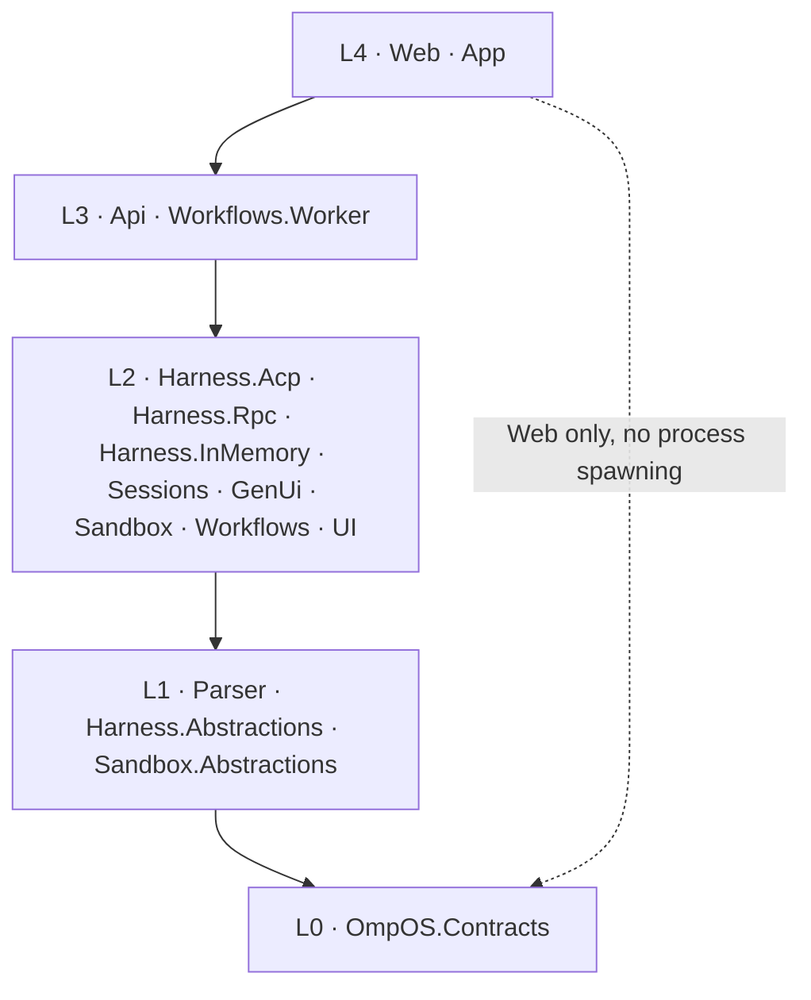

# OmpOS architecture

Foundation phase. The product code (parser, harness, sessions, API, UI) arrives in Phases 2–4; this document records the layering every later phase must respect.

## Layer diagram

Dependency direction is apps → services → libraries → contracts, enforced mechanically by `tests/OmpOS.ArchitectureTests` (csproj-graph test plus ArchUnitNET type rules). Nothing references `OmpOS.Api` except tests. `OmpOS.Web` never references the process-spawning harness assemblies (`Harness.Acp`, `Harness.Rpc`).

## Components

| Component | Layer | Responsibility |
| --------- | ----- | -------------- |
| `OmpOS.Contracts` | L0 | Single source of truth: Session, Message, IntentEnvelope, UiBlock, StreamEvent (`Seq`), SandboxDescriptor, WorkflowRun, errors, `ContractVersion` |
| `OmpOS.Parser` | L1 | Catch-all prompt parser: ordered recognizers plus an unremovable fallback (Phase 2) |
| `OmpOS.Harness.Abstractions` | L1 | Transport, session, and event abstractions plus the harness state machine (Phase 2) |
| `OmpOS.Sandbox.Abstractions` | L1 | Sandbox provider abstraction (Phase 3) |
| `OmpOS.Harness.Acp` | L2 | ACP v1 client over `omp acp` stdio (Phase 2) |
| `OmpOS.Harness.Rpc` | L2 | omp native JSONL client over `omp --mode rpc` (Phase 2) |
| `OmpOS.Harness.InMemory` | L2 | Deterministic scripted adapter for the vertical slice (Phase 2) |
| `OmpOS.Sessions` | L2 | Append-only sequence-numbered session log and repository (Phase 2) |
| `OmpOS.GenUi` | L2 | Reducer from protocol events to `StreamEvent` to `UiBlock` (Phase 2) |
| `OmpOS.Sandbox` | L2 | Fake, local podman-compose, and vendor-stub providers (Phase 3) |
| `OmpOS.Workflows` | L2 | `ISessionRunWorkflow` plus activities; `DirectSessionRunner` default (Phase 3) |
| `OmpOS.UI` | L2 | Shared Razor chat surface: list, session view, composer, block renderer (Phase 4) |
| `OmpOS.Api` | L3 | Session/prompt endpoints, resumable SSE stream, health, OpenAPI (Phase 2) |
| `OmpOS.Workflows.Worker` | L3 | Temporal worker host behind `Workflows:Enabled` (Phase 3) |
| `OmpOS.Web` | L4 | Blazor WebAssembly standalone head, static publish to Vercel (Phase 4) |
| `OmpOS.App` | L4 | .NET MAUI Blazor Hybrid head sharing `OmpOS.UI` (Phase 4) |

`OmpOS.Api` and `OmpOS.Workflows.Worker` are class-library placeholders in Phase 1. They are converted to the web and worker SDKs when their hosts are built in Phase 2 and Phase 3.

## Data flow

A prompt typed on any surface becomes an `IntentEnvelope` (parser), runs through a harness session against omp, lands as sequence-numbered `StreamEvent`s in the session log, streams out over SSE with `id:` = `Seq`, and folds into `UiBlock`s rendered by the shared Razor surface. Unknown JSON kinds never throw: they deserialize to `UnknownBlock`/`UnknownPayload` with the raw payload preserved, so future protocol additions render through the unknown fallback instead of breaking clients.

## Decisions

- [ADR-0001](decisions/ADR-0001-monorepo-layout.md) — monorepo layout and dependency layers.
- [ADR-0002](decisions/ADR-0002-surface-technology.md) — surfaces, streaming, engine integration, workflows, sandbox layering.
