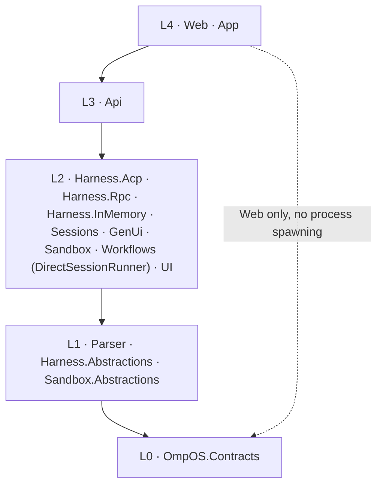

# OmpOS architecture

This document records the layering every later phase must respect, and the session run path as decided on 2026-10-21. Temporal is removed; session runs execute in-process in the API. See [Temporal removal and Railway topology (2026-10-21)](handoff.md#temporal-removal-and-railway-topology-2026-10-21).

## Layer diagram

Dependency direction is apps → services → libraries → contracts, enforced mechanically by `tests/OmpOS.ArchitectureTests` (csproj-graph test plus ArchUnitNET type rules). Nothing references `OmpOS.Api` except tests. `OmpOS.Web` never references the process-spawning harness assemblies (`Harness.Acp`, `Harness.Rpc`).

There is no worker layer. The Temporal worker project was removed on 2026-10-21, and no separate worker process runs.

## Components

| Component | Layer | Responsibility |
| --------- | ----- | -------------- |
| `OmpOS.Contracts` | L0 | Single source of truth: Session, Message, IntentEnvelope, UiBlock, StreamEvent (`Seq`), SandboxDescriptor, WorkflowRun, errors, `ContractVersion` |
| `OmpOS.Parser` | L1 | Catch-all prompt parser: ordered recognizers plus an unremovable fallback (Phase 2) |
| `OmpOS.Harness.Abstractions` | L1 | Transport, session, and event abstractions plus the harness state machine (Phase 2) |
| `OmpOS.Sandbox.Abstractions` | L1 | Sandbox provider abstraction (Phase 3) |
| `OmpOS.Harness.Acp` | L2 | ACP v1 client over `omp acp` stdio (Phase 2) |
| `OmpOS.Harness.Rpc` | L2 | omp native JSONL client over `omp --mode rpc` (Phase 2) |
| `OmpOS.Harness.InMemory` | L2 | Deterministic scripted adapter for the vertical slice (Phase 2) |
| `OmpOS.Sessions` | L2 | Append-only sequence-numbered session log and repository (Phase 2) |
| `OmpOS.GenUi` | L2 | Reducer from protocol events to `StreamEvent` to `UiBlock` (Phase 2) |
| `OmpOS.Sandbox` | L2 | Fake, local podman-compose, and vendor-stub providers (Phase 3) |
| `OmpOS.Workflows` | L2 | In-process session run path: `DirectSessionRunner`, the only run path after the Temporal removal (Phase 3; library name pending the code cutover [INFERENCE]) |
| `OmpOS.UI` | L2 | Shared Razor chat surface: list, session view, composer, block renderer (Phase 4) |
| `OmpOS.Api` | L3 | Session/prompt endpoints, resumable SSE stream, health, OpenAPI, and in-process session runs (Phase 2) |
| `OmpOS.Web` | L4 | Blazor WebAssembly standalone head, static publish to Vercel (Phase 4) |
| `OmpOS.App` | L4 | .NET MAUI Blazor Hybrid head sharing `OmpOS.UI` (Phase 4) |

`OmpOS.Api` is a class-library placeholder in Phase 1 and is converted to the web SDK host in Phase 2.

## Data flow

A prompt typed on any surface becomes an `IntentEnvelope` (parser), runs through a harness session against omp, lands as sequence-numbered `StreamEvent`s in the session log, streams out over SSE with `id:` = `Seq`, and folds into `UiBlock`s rendered by the shared Razor surface. Unknown JSON kinds never throw: they deserialize to `UnknownBlock`/`UnknownPayload` with the raw payload preserved, so future protocol additions render through the unknown fallback instead of breaking clients.
2026-10-20: that stream is served over HTTP as `GET /sessions/{id}/events` (SSE with `id:` = `Seq`, resume via `Last-Event-ID` or `?since=`, terminal `completed`/`error` ends the response), alongside the session endpoints documented in `docs/api/openapi.json`.

## Session run path (in process)

Session runs execute inside the API process. No separate worker service exists.

- **Admission is synchronous.** The API acquires the run lease `ompos:lease:run:{sessionId}` (TTL 30 s, renewed every 10 s) before it answers. A conflicting lease returns 409 before any 202 is sent.
- **Execution.** `DirectSessionRunner` provisions a sandbox through `ISandboxProvider`, runs the prompt through the harness, collects artifacts, and tears down the sandbox in `finally`. The hosted API runs the InMemory harness and `FakeSandboxProvider` (see [hosting runbook](runbooks/hosting.md)).
- **Retry** lives in `DirectSessionRunner` and the run lease only.
- **Reaper.** Every 15 s, a Running session older than 60 s whose lease is absent is settled as a terminal failure with detail `run owner lost`. A lost lease settles the run with detail `run lease lost`. Terminal failure detail is persisted in the terminal event text.
- **Idempotency.** Prompt submission takes an optional `Idempotency-Key` header. A completed record lasts 24 h; a pending claim lasts 60 s. A replay returns the stored 202 body. The same key with a different body returns 409 `/problems/idempotency-key-reused`. A concurrent claim returns 409 `/problems/idempotency-in-progress`.
- **Streaming.** SSE is served from the session log. Polling (about 200 ms) is the source of truth for SSE. Signals only wake pollers (see Coordination).

## Stores

- **Session log**: `Sessions:Store` is `Postgres` or `InMemory`. It defaults to `InMemory` in `appsettings.json` for Development only; Production refuses to start unless it is `Postgres`, and the startup error names `Sessions:Store`. Hosted, the store is PostgreSQL 16 with TimescaleDB 2.13 (Railway template image `timescale-postgis-ssl:pg16-ts2.13`, TLS on), schema `ompos`. The session log is a hypertable on `occurred_at` with 1-day chunks and primary key `(session_id, seq, occurred_at)`. The DDL has not been executed against the hosted database (open item Q-DATA-TSDB-VERSION).
- The connection string is `Sessions:Postgres:ConnectionString` (Npgsql). Production uses `Ssl Mode=Require;Trust Server Certificate=true`, because the template uses a self-signed TLS certificate on the private network.

## Coordination

- **Store**: `Coordination:Store` is `Dragonfly` or `InMemory`. It defaults to `InMemory` in `appsettings.json`; production must set it explicitly, and a warning is logged in Production when it is `InMemory`. The connection string is `Coordination:Dragonfly:ConnectionString` (StackExchange.Redis format; `abortConnect=false` is required).
- Dragonfly holds three things: run leases (`ompos:lease:run:{sessionId}`), idempotency records (`ompos:idem:*`), and the SSE wake-up pub/sub channel `ompos:signals`.
- Signals are published after commit. Publishing is best-effort: failures are logged and swallowed. Because polling is the source of truth, a missed signal delays a stream until the next poll [INFERENCE: from the polling design; not measured].
- The hosted Dragonfly image is `ghcr.io/dragonflydb/dragonfly:latest`, unpinned (open item Q-HOST-DFLY-PIN).

## Telemetry

- `Otel:Exporter` is `none` (default), `console`, or `otlp`.
- The OTLP endpoint, protocol, and headers come only from `OTEL_EXPORTER_OTLP_*` variables. The Authorization header is set only in the hosting environment and is never committed.
- Hosted, the target is GreptimeDB `greptime/greptimedb:v1.1.4` over OTLP HTTP/protobuf at `/v1/otlp` (paths `/v1/traces` and `/v1/metrics`). Traces need the header `X-Greptime-Pipeline-Name=greptime_trace_v1` in the general `OTEL_EXPORTER_OTLP_HEADERS` variable, not in `OTEL_EXPORTER_OTLP_TRACES_HEADERS` (smoke evidence finding 1: [evidence](runbooks/evidence/smoke-backend-local-2026-10-21.md)). GreptimeDB has auth enabled (static user provider), so OTLP requires Basic auth.
- Whether the private path `greptimedb.railway.internal:4000` is reachable from an IPv6-only environment is unverified (open item Q-HOST-PRIVNET). The fallback is the public service domain over HTTPS.

## Hosting topology

Railway project `Ultrathink`, environment `production`. The service list, variable names, and deploy steps are in [docs/runbooks/hosting.md](runbooks/hosting.md). Vercel hosts the Blazor WebAssembly web head outside Railway.

## Decisions

- [ADR-0001](decisions/ADR-0001-monorepo-layout.md): monorepo layout and dependency layers. Amended 2026-10-21: the Temporal volume note is superseded.
- [ADR-0002](decisions/ADR-0002-surface-technology.md): surfaces, streaming, engine integration, sandbox layering. Amended 2026-10-21: the Temporal part of the workflows bullet is superseded.
- [ADR-0003](decisions/ADR-0003-workflow-routing.md): workflow routing. Superseded 2026-10-21; `DirectSessionRunner` in the API is the only run path.
- [Temporal removal and Railway topology (2026-10-21)](handoff.md#temporal-removal-and-railway-topology-2026-10-21): the decision text and its supersessions.
