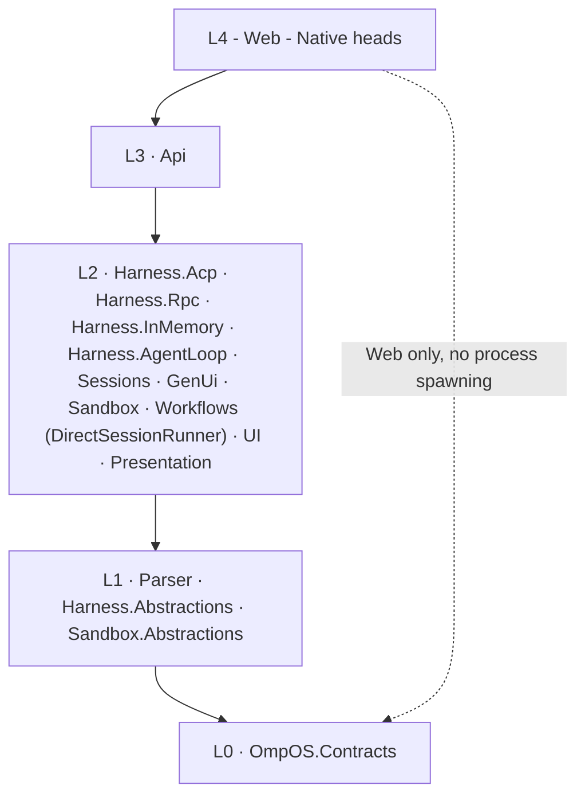
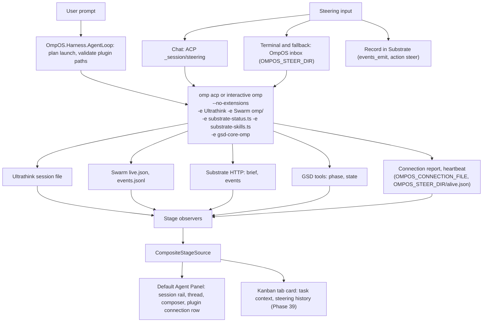

# OmpOS architecture

Status: Built (the layers and the session run path); hooks, remote, containers, cloud and automations are Partial: wired into the heads and tested with fakes, not run with a model turn, see the parity audit

Last verified: 2026-10-28

Applies to: v0.15.0

This document records the layering every later phase must respect, and the session run path as decided on 2026-10-21. Temporal is removed; session runs execute in-process in the API. See [Temporal removal and Railway topology (2026-10-21)](handoff.md#temporal-removal-and-railway-topology-2026-10-21).

## Overview


*Hand-drawn diagram. The Railway band is the intended topology: the API is not deployed and only a staged private worker runs there (2026-10-28).*

- **Heads** (`apps/`): the Avalonia desktop head, the Blazor WebAssembly web head and the Android head. A head owns windows, process lifetime and platform services, and nothing else.
- **Presentation layer** (`src/OmpOS.Presentation`, `OmpOS.Native.Views`, `OmpOS.UI`): view models with no UI framework, drawn by Avalonia views on desktop and Android and by Razor components on the web. The web head also has a styled shell (top bar, agent rail, footer, theme switch) on White-and-Purple tokens, and a **Demo** build whose HTTP client is answered inside the browser ([ADR-0017](decisions/ADR-0017-web-head-demo-mode.md)).
- **API** (`services/OmpOS.Api`): sessions, runs, server-sent events, tool approvals, the change review, steering, providers, workspace settings, the source offer, and the cloud agent control plane.
- **Harness** (`src/OmpOS.Harness.*`): the libraries that talk to omp (ACP over stdio), plan a launch with the four plugins, run Cursor-compatible hooks through a loopback bridge and an omp extension, enforce run modes, read MCP configuration, keep file checkpoints and worktrees, resolve `@` mentions and ignore files, and reach a remote machine over your own `ssh`.
- **omp**: the engine. OmpOS starts `omp acp` per chat session and an embedded omp terminal on request, always with Ultrathink, Substrate, Swarm and GSD-Core.
- **Worker and Railway**: the cloud agent path (API, `OmpOS.AgentWorker`, PostgreSQL). Built and tested against fakes; no Railway deploy of the API has happened. A staged private worker was deployed to Railway and exercised on 2026-10-28 ([evidence](runbooks/evidence/railway-ompos-worker-2026-10-28.md)).

### What is built where

| Piece | Where | Status |
|---|---|---|
| Desktop head: Agents window, Kanban, terminals, Changes bar, steering, Settings (21 pages and Automations) | `apps/OmpOS.Native`, `src/OmpOS.Native.Views` | Built, Linux only; composition root `Composition/HeadServices` builds the hooks, MCP, run mode, checkpoint, remote, cloud and automation services once per head |
| Web head: shell, agent rail, thread, composer, Kanban, Settings dialog (18 pages), terminal view | `apps/OmpOS.Web`, `src/OmpOS.UI` | Built; the Demo is deployed at https://ompos-web.vercel.app; see the [Web app guide](guides/web-app-guide.md) |
| Hooks | `Harness.Plugins/Hooks`, `Harness.Acp`, hooks omp extension, `Native/Composition`, `AgentWorker/Hooks` | Partial: wired into desktop sessions and cloud workers, proven with fakes; not run against a live omp ([Hooks](reference/hooks.md)) |
| Run modes, mentions, MCP import and presets, checkpoints, fork, side chats | `Harness.AgentLoop/Safety`, `Harness.Workspace`, `Harness.Mcp`, `Native/Composition` | Partial: wired into the desktop head, wiring tests with fake engines |
| Remote environments over ssh | `src/OmpOS.Harness.Remote` | Partial: a live run through a loopback `sshd` with the real omp passed; no real network host ([Remote](runbooks/remote-ssh.md)) |
| Containers (podman) and WSL | `src/OmpOS.Harness.Remote` | Partial: a live podman test passed on Linux; WSL never ran ([Containers](runbooks/remote-containers.md)) |
| Multi-repo workspaces | `src/OmpOS.Harness.Workspace` (`WorkspaceSet`), `Harness.Worktrees` | Partial ([Multi-repo](runbooks/multi-repo.md)) |
| Automations | `src/OmpOS.Harness.Automations`, `Native/Composition/Automations`, `services/OmpOS.Api/Automations` | Partial: desktop scheduler and API routes (off by default) ([Automations](reference/automations.md)) |
| Cloud agents | `services/OmpOS.Api/Cloud`, `services/OmpOS.AgentWorker`, `src/OmpOS.Sandbox`, `Native/Cloud` | Partial: fakes only ([Cloud agents](runbooks/cloud-agents.md)) |
| Provider catalogue | `src/OmpOS.Harness.Providers` | Built as data and UI in both heads; no real credential used ([Providers](guides/providers-guide.md)) |

The authoritative status of every Cursor feature is the [parity audit](quality/cursor-parity-audit-2026-10-28.md).

## Layer diagram



Dependency direction is apps → services → libraries → contracts, enforced mechanically by `tests/OmpOS.ArchitectureTests` (csproj-graph test plus ArchUnitNET type rules). Nothing references `OmpOS.Api` except tests. `OmpOS.Web` never references the process-spawning harness assemblies (`Harness.Acp`, `Harness.Rpc`).

There is no Temporal worker: it was removed on 2026-10-21 and session runs execute in the API process. One separate process exists for cloud agents only: `services/OmpOS.AgentWorker` runs inside a cloud agent's environment and bridges the API to an omp process over a WebSocket ([ADR-0020](decisions/ADR-0020-cloud-agents-on-railway.md)).

## Components

| Component | Layer | Responsibility |
| --------- | ----- | -------------- |
| `OmpOS.Contracts` | L0 | Single source of truth: Session, Message, IntentEnvelope, UiBlock, StreamEvent (`Seq`), SandboxDescriptor, WorkflowRun, errors, `ContractVersion` |
| `OmpOS.Parser` | L1 | Catch-all prompt parser: ordered recognizers plus an unremovable fallback (Phase 2) |
| `OmpOS.Harness.Abstractions` | L1 | Transport, session, and event abstractions plus the harness state machine (Phase 2) |
| `OmpOS.Sandbox.Abstractions` | L1 | Sandbox provider abstraction (Phase 3) |
| `OmpOS.Harness.Acp` | L2 | ACP v1 client over `omp acp` stdio (Phase 2) |
| `OmpOS.Harness.AgentLoop` | L2 | Agent loop (v0.14.0): plugin catalogue and resolver for the pinned submodules, the pure launch planner and per-session state layout, observers that project Ultrathink, Swarm, Substrate and GSD state into `StageEvent`s, the Substrate gateway, the GSD tools client, and the session registry (`ISessionCatalog`). References only `OmpOS.Contracts` and `OmpOS.Harness.Abstractions`. May spawn processes (`node` for GSD tools). See [Agent loop](#agent-loop) and [ADR-0012](decisions/ADR-0012-agent-loop-plugins.md). |
| `OmpOS.Harness.Rpc` | L2 | omp native JSONL client over `omp --mode rpc` (Phase 2) |
| `OmpOS.Harness.InMemory` | L2 | Deterministic scripted adapter for the vertical slice (Phase 2) |
| `OmpOS.Sessions` | L2 | Append-only sequence-numbered session log and repository (Phase 2) |
| `OmpOS.GenUi` | L2 | Reducer from protocol events to `StreamEvent` to `UiBlock` (Phase 2) |
| `OmpOS.Sandbox` | L2 | Fake, local podman-compose, and vendor-stub providers (Phase 3) |
| `OmpOS.Workflows` | L2 | In-process session run path: `DirectSessionRunner`, the only run path after the Temporal removal (Phase 3; library name pending the code cutover [INFERENCE]) |
| `OmpOS.UI` | L2 | Razor chat surface for the Blazor WebAssembly web head: list, session view, composer, block renderer (Phase 4). Under ADR-0004 it remains the web head's UI; the native heads bind the framework-neutral presentation layer instead. |
| `OmpOS.Presentation` | L2 | Framework-neutral presentation layer (Phase 20): view models and state (`SessionViewModel`, `ComposerViewModel`, `ConversationListState`), tool approvals and run input, `MotionPreference`, the plugin host (`PluginHost`), and change notification through `ObservableModel` (OQ-44). References no UI framework (`PresentationIsolationTests`). Consumed by `OmpOS.UI` (web head) and `OmpOS.Native` (Avalonia head). |
| `OmpOS.Api` | L3 | Session/prompt endpoints, resumable SSE stream, health, OpenAPI, and in-process session runs (Phase 2) |
| `OmpOS.Web` | L4 | Blazor WebAssembly standalone web head, which stays Blazor WebAssembly under ADR-0004; static publish to Vercel (Phase 4) |
| `OmpOS.App` | L4 | Superseded 2026-10-21 by ADR-0004: the .NET MAUI Blazor Hybrid head sharing `OmpOS.UI` (Phase 4) retires by clean cutover after parity tests (v0.10.0 Phase 25). Its replacement, the Avalonia UI native heads for Windows, macOS, Linux, iOS and Android, has its first project in the repo (`OmpOS.Native`, Phase 20); the other platform heads are not yet in the repo. |
| `OmpOS.Native` | L4 | Avalonia 12.1.4 desktop shell (Phase 20). Binds the `OmpOS.Presentation` view models through an explicit `ViewMapping` (no `ViewLocator`), with one token dictionary (`Themes/OmpOSTokens.axaml`). Headless tests live in `tests/OmpOS.Native.Tests`. Per-platform runs for Linux, Windows, macOS, iOS and Android are not yet recorded (Phases 22 and 24). |

`OmpOS.Api` is an ASP.NET Core web host (converted from a Phase 1 placeholder in Phase 2).

### Projects added or extended in v0.15.0

| Project | Responsibility |
| ------- | -------------- |
| `OmpOS.Harness.Remote` | Remote environments over your own `ssh`: profiles, `ssh -G` resolution, connection test, launch rewrite, reconnect, remote file system and terminals |
| `OmpOS.Harness.Mcp` (extended) | Reads MCP configuration files of OmpOS, Cursor, Claude Code and VS Code and builds the server list offered to a session |
| `OmpOS.Harness.Providers` | The provider catalogue as data (`Data/catalogue-*.json`), the omp configuration writer and the plan rules |
| `OmpOS.Harness.Worktrees` | Git worktree manager and applier for runs, with setup scripts |
| `OmpOS.Harness.Workspace` | Workspace snapshot, conventions, Cursor-style ignore files, file checkpoints, and workspace sets (several roots in one session) |
| `OmpOS.Harness.AgentLoop` (extended) | Hooks service and loopback bridge, run modes and permissions, safety policy |
| `OmpOS.Sandbox` (extended) | Cloud environment client for Railway, a static pool client, a cloud session host |
| `OmpOS.AgentWorker` | The cloud agent worker: JWT-authenticated WebSocket bridge to `omp acp` |

## Data flow

A prompt typed on any surface becomes an `IntentEnvelope` (parser), runs through a harness session against omp, lands as sequence-numbered `StreamEvent`s in the session log, streams out over SSE with `id:` = `Seq`, and folds into `UiBlock`s rendered by the web head's Razor surface (`OmpOS.UI`). The Avalonia native head (`OmpOS.Native`, Phase 20) binds the shared presentation layer that ADR-0004 specifies; the other platform heads are not yet in the repo. Unknown JSON kinds never throw: they deserialize to `UnknownBlock`/`UnknownPayload` with the raw payload preserved, so future protocol additions render through the unknown fallback instead of breaking clients.
2026-10-20: that stream is served over HTTP as `GET /sessions/{id}/events` (SSE with `id:` = `Seq`, resume via `Last-Event-ID` or `?since=`, terminal `completed`/`error` ends the response), alongside the session endpoints documented in `docs/api/openapi.json`.

## Session run path (in process)

Session runs execute inside the API process. No separate worker service exists.

- **Admission is synchronous.** The API acquires the run lease `ompos:lease:run:{sessionId}` (TTL 30 s, renewed every 10 s) before it answers. A conflicting lease returns 409 before any 202 is sent.
- **Execution.** `DirectSessionRunner` provisions a sandbox through `ISandboxProvider`, runs the prompt through the harness, collects artifacts, and tears down the sandbox in `finally`. The hosted API runs the InMemory harness and `FakeSandboxProvider` (see [hosting runbook](runbooks/hosting.md)).
- **Retry** lives in `DirectSessionRunner` and the run lease only.
- **Reaper.** Every 15 s, a Running session older than 60 s whose lease is absent is settled as a terminal failure with detail `run owner lost`. A lost lease settles the run with detail `run lease lost`. Terminal failure detail is persisted in the terminal event text.
- **Idempotency.** Prompt submission takes an optional `Idempotency-Key` header. A completed record lasts 24 h; a pending claim lasts 60 s. A replay returns the stored 202 body. The same key with a different body returns 409 `/problems/idempotency-key-reused`. A concurrent claim returns 409 `/problems/idempotency-in-progress`.
- **Streaming.** SSE is served from the session log. Polling (about 200 ms) is the source of truth for SSE. Signals only wake pollers (see Coordination).

## Agent loop

The agent loop runs the Ultrathink, Swarm, Substrate and GSD-Core plugins inside every omp process the application starts: the engine session (`omp acp`, one per session) and the omp terminals (an interactive omp in the embedded terminal), planned by the same launch planner (Phase 48, DR-2; verified without a model turn on Linux, see [docs/plugins.md](plugins.md#plugins-in-omp-terminals)). OmpOS launches them and observes their side channels: files, HTTP, and a connection report that the `gsd-core-omp` plugin writes. What they expose is shown in the default Cursor-style Agent Panel (session rail, thread, composer and a one-line plugin connection row); that panel has no inspector and no stage panels of its own (DR-1). Task context and steering history belong on the Kanban tab card (Phase 39). Plugin details: [docs/plugins.md](plugins.md). Operation: [docs/runbooks/agent-loop.md](runbooks/agent-loop.md).

Contracts (`OmpOS.Contracts.Agents`, L0, no `StreamEvent` kind and no `ContractVersion` change): `StageSource` (Omp, Ultrathink, Swarm, Substrate, Gsd), `StageStatus` (Pending, Running, Succeeded, Degraded, Failed, Skipped, Unavailable), `StageEvent`, `StageObservationScope`, `IStageSource`, `SessionLifecycle` (Created, Running, Paused, Completed, Failed, Lost), `SessionSummary`, `ISessionCatalog`, `ContextNote`, `GsdPhaseInfo`, `TaskContext`, `ITaskContextSource`.



Steering depends on the session. A chat (ACP) session sends omp's native `_session/steering` request when omp advertises it; an omp terminal, which has no ACP, and an omp without the capability use the inbox of the `gsd-core-omp` plugin; queue after the turn is the last fallback. Substrate only records the steering action and does not deliver it (OQ-66). Delivery into a running turn is verified without a model turn only up to the wire contract and the inbox heartbeat; an `injected` outcome is not verified (OQ-81, ADR-0012 update). An observer that cannot read its source emits a Degraded or Unavailable stage event instead of throwing, so the panel and the run continue.

Session state directory layout (from `SessionStateLayout`; `<stateRoot>` is `AgentLoopSettings.StateRoot`):

```
<stateRoot>/sessions/<sessionId>/
  ultrathink/                    ULTRATHINK_STATE_DIR
    sessions/<acpSessionId>.json   written once planning finishes
  swarm/                         SWARM_DIR
    .swarm/live.json
    .swarm/events.jsonl
  claude-state/                  SWARM_CLAUDE_STATE_DIR
  substrate-pending/             SUBSTRATE_OMP_PENDING_DIR
  swarm/gsd-state.md             SWARM_GSD_STATE_FILE (a per-session path, never empty)
  steer/                         OMPOS_STEER_DIR: inbox/, acks/, done/, alive.json
  connection/report.json         OMPOS_CONNECTION_FILE
```

A session id must match `^[A-Za-z0-9_.-]{1,120}$` and must not be `.` or `..`. An observer reads only its own session directory.

## Stores

- **Session log**: `Sessions:Store` is `Postgres` or `InMemory`. It defaults to `InMemory` in `appsettings.json` for Development only; Production refuses to start unless it is `Postgres`, and the startup error names `Sessions:Store`. Hosted, the store is PostgreSQL 16 with TimescaleDB 2.13 (Railway template image `timescale-postgis-ssl:pg16-ts2.13`, TLS on), schema `ompos`. The session log is a hypertable on `occurred_at` with 1-day chunks and primary key `(session_id, seq, occurred_at)`. The DDL has not been executed against the hosted database (open item Q-DATA-TSDB-VERSION).
- The connection string is `Sessions:Postgres:ConnectionString` (Npgsql). Production uses `Ssl Mode=Require;Trust Server Certificate=true`, because the template uses a self-signed TLS certificate on the private network.

## Coordination

- **Store**: `Coordination:Store` is `Dragonfly` or `InMemory`. It defaults to `InMemory` in `appsettings.json`; production must set it explicitly, and a warning is logged in Production when it is `InMemory`. The connection string is `Coordination:Dragonfly:ConnectionString` (StackExchange.Redis format; `abortConnect=false` is required).
- Dragonfly holds three things: run leases (`ompos:lease:run:{sessionId}`), idempotency records (`ompos:idem:*`), and the SSE wake-up pub/sub channel `ompos:signals`.
- Signals are published after commit. Publishing is best-effort: failures are logged and swallowed. Because polling is the source of truth, a missed signal delays a stream until the next poll [INFERENCE: from the polling design; not measured].
- The hosted Dragonfly image is `ghcr.io/dragonflydb/dragonfly:latest`, unpinned (open item Q-HOST-DFLY-PIN).

## Telemetry

- `Otel:Exporter` is `none` (default), `console`, or `otlp`.
- The OTLP endpoint, protocol, and headers come only from `OTEL_EXPORTER_OTLP_*` variables. The Authorization header is set only in the hosting environment and is never committed.
- Hosted, the target is GreptimeDB `greptime/greptimedb:v1.1.4` over OTLP HTTP/protobuf at `/v1/otlp` (paths `/v1/traces` and `/v1/metrics`). Traces need the header `X-Greptime-Pipeline-Name=greptime_trace_v1` in the general `OTEL_EXPORTER_OTLP_HEADERS` variable, not in `OTEL_EXPORTER_OTLP_TRACES_HEADERS` (smoke evidence finding 1: [evidence](runbooks/evidence/smoke-backend-local-2026-10-21.md)). GreptimeDB has auth enabled (static user provider), so OTLP requires Basic auth.
- Whether the private path `greptimedb.railway.internal:4000` is reachable from an IPv6-only environment is unverified (open item Q-HOST-PRIVNET). The fallback is the public service domain over HTTPS.

## Hosting topology

Railway project `Ultrathink`, environment `production`. The service list, variable names, and deploy steps are in [docs/runbooks/hosting.md](runbooks/hosting.md). Vercel hosts the Blazor WebAssembly web head outside Railway.

## Decisions

- [ADR-0001](decisions/ADR-0001-monorepo-layout.md): monorepo layout and dependency layers. Amended 2026-10-21: the Temporal volume note is superseded.
- [ADR-0002](decisions/ADR-0002-surface-technology.md): surfaces, streaming, engine integration, sandbox layering. Amended 2026-10-21: the Temporal part of the workflows bullet is superseded. The UI stack decisions are superseded 2026-10-21 by ADR-0004.
- [ADR-0003](decisions/ADR-0003-workflow-routing.md): workflow routing. Superseded 2026-10-21; `DirectSessionRunner` in the API is the only run path.
- [ADR-0004](decisions/ADR-0004-cross-platform-ui.md): cross-platform UI. Accepted 2026-10-21: Avalonia UI for the five native heads; the web head stays Blazor WebAssembly on the shared presentation layer. The MAUI head retires after parity (v0.10.0 Phase 25).
- [Temporal removal and Railway topology (2026-10-21)](handoff.md#temporal-removal-and-railway-topology-2026-10-21): the decision text and its supersessions.
- [ADR-0012](decisions/ADR-0012-agent-loop-plugins.md): agent loop plugins. Accepted 2026-10-26: Ultrathink, Swarm and Substrate as pinned submodules and `plugins/gsd-core-omp` as a tracked plugin, launched inside `omp acp` with `-e`. Update 2026-10-26: no additional Agent Panel and no inspector (DR-1), plugins in every app-started omp process, engine session and terminals (DR-2), live steering required; implemented as omp's native `_session/steering` for chat sessions and the OmpOS inbox for terminals and as the fallback, Substrate records only (DR-4, OQ-81).
