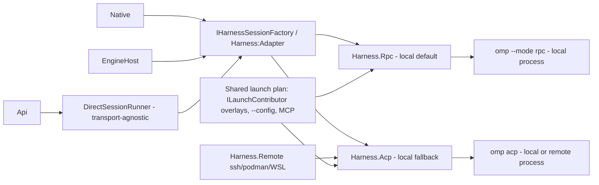

# Architecture blueprint: v0.17.0 Omp RPC engine rearchitecture (T9013-arch)

Task T9013-arch, correlation 901308c5-825d-45fe-8832-36b59c0771ae, capability design.blueprint.
Inputs: `docs/requirements/spec-T9013-req.md` (PROVISIONAL, US-301..US-310), `acceptance-T9013.md`, `nfr-T9013.md`; owner directive (parent brief): RPC primary local transport, ACP retained for the remote boundary, PTY terminal engine retired.
Decision record: ADR-0038 (`docs/decisions/ADR-0038-omp-rpc-primary-transport.md`), status Proposed until the Phase 84 cutover gate.
Note on the milestone label: "v0.17.0" is the programme label assigned for phases 79-84. The shipped product version is already on the 0.20.x line (Phase 78); this blueprint authorises no `VersionPrefix` change.

## Ground truth used (observed in this pass, not invented)

- `src/Autonogrammer.Harness.Rpc/` exists with `OmpRpcClient` returning `IOmpSession` (`Harness.Abstractions/IOmpSession.cs`), `RpcHarnessSessionFactory`, `RpcChunkAssembler`, `RpcEventMapper`, `OmpVersionProbe` pinning every start; tests in `tests/Autonogrammer.Harness.Rpc.Tests/`; zero production consumers (Phase 79 recounts).
- ACP carries production today: `AcpAgentSession : IOmpSession` (+ steering/model/commands/options/fork satellites), composed by EngineHost `InProcessEngineHost` (an injectable `Func<IOmpSession>` factory — the Phase 80 selection seam already exists there), Api `DirectSessionRunner`/`AcpHarnessSessionFactory`, AgentWorker, Native, `Harness.Remote`.
- Terminal sessions: `SessionKind.Terminal` created in `apps/Autonogrammer.Native/Agents/SessionEngineSet.cs`, started via `PlannedOmpTerminalStarter`. `src/Autonogrammer.Harness.Herdr/` is isolated (C4 check below). Provisioning (`OmpManagedInstaller`, `OmpLocator`) is kept.
- The API contract `docs/api/openapi.json` is unchanged by this milestone: `arch_contract_check.py` (and its bun twin) report OpenAPI 3.1.1, info.version 1.1.0, 114 operations, 0 breaking changes, verdict pass. Transport selection is internal (`Harness:Adapter` option, Phase 80); SSE event shapes do not change.
- omp 19.1.1 installed vs verified 18.12.3/18.12.6: every 19.x protocol fact (ready frame, `negotiate_protocol` v2, `rpc_chunk` caps, command delta, `--no-ui`, RPC approvals, plugin loading under `--mode rpc`) is an open question (OQ-520..526) until Phase 79/82 evidence lands. No live model turn (OD-07).

## C4 container view (target state after Phase 84)

Retired: PTY terminal engine (`PlannedOmpTerminalStarter`, Phase 81), `Harness.Herdr` (Phase 81). Kept: omp provisioning, ACP for the remote boundary, SSE resume contract.

Layer order (outermost to innermost): `apps`, `services`, `harness`, `contracts`. RPC promotion adds no upward edge: `Harness.Rpc` already sits in the harness layer behind `IOmpSession`.

## Fitness results (registry tools, this pass)

| Check | Tool | Result |
|---|---|---|
| C4 fan-out, budget 3 | `arch_c4_fanout` | 10 containers, 8 relations, max fan-out 1, over_budget [], isolated [Harness.Herdr] |
| Cycles | `arch_cycle_check` | has_cycle false, 0 cyclic nodes |
| Layer direction | `arch_layer_violations` | 0 violations over 4 checked edges |
| NFR allocation | `arch_nfr_allocation` | coverage 100%, fully_allocated true (table below) |
| Verdict over findings [minor: Herdr isolated] | `shared_verdict` | pass |

The one minor finding (Herdr isolated) is evidence for its Phase 81 deletion, not a waiver.

## NFR bindings (from nfr-T9013.md)

| NFR | Binding | Limit |
|---|---|---|
| NFR-P3 | Targeted verification wall budget, Phases 79-84 | 1800 s, 0 timeouts |
| NFR-S3 | Secret scan over the milestone diff, Phase 84 gate; SEC-77-01 stays open | 0 findings, 0 waivers |
| NFR-A3 | axe over Phase 81 terminal-retirement session states | 0 new errors at 1440/1024/390 px |
| NFR-I3 | Hardcoded user-facing literals in Phase 81 surfaces | 0 |
| NFR-C3 | Artefacts carry task/correlation ids; fabricated tracker ids | 0 fabricated |

## Contract

No `api.contract` change is published by this task. `docs/api/openapi.json` 1.1.0 (114 operations) stays pinned; `breaking_change` is false per the contract check above. The internal protocol contract (RPC handshake, commands, chunking) is frozen as evidence in Phase 79, not as a published API. Phase 81 re-checks the served document because removing a session kind can change it; a change there takes the breaking-change gate before merge.

## Threat model (summary, STRIDE)

| Boundary | Threat | Mitigation in design |
|---|---|---|
| omp child process (RPC stdio, local) | Spoofing/tamper via a replaced binary | Provisioning stays; `OmpVersionProbe` pin runs on every RPC start; Phase 79 records observed 19.1.1 output, no silent pin move |
| RPC approvals | Elevation if RPC lacks an ACP-equivalent permission request | Deny-by-default until OQ-525 closes; approval-capable flows stay on ACP absent a verified mapping |
| PTY terminal sessions | Elevation: TUI runs with shell rights inside the app | Phase 81 retires the owner; persisted records read-only (OQ-527) |
| Remote ACP (ssh/podman/WSL/WebSocket) | Boundary drift if launch plans fork | One shared launch plan (Phase 83 asserts it); remote approval policy unchanged |
| Plugin overlays (`--config`, skills, MCP) | Tamper or silent non-loading under `--mode rpc` | Phase 82 proves loading per contribution point; `agent-realm` never listed active while uninitialised (OQ-528) |

## Phase map

| Phase | Scope | Requirements |
|---|---|---|
| 79 | omp 19.1.1 re-verification & protocol contract: RPC+ACP handshake, fixture freeze, drift vs 18.12.x, version pin/probe (Wave 1 execute) | RPC-79-1..4 |
| 80 | RPC engine transport production wiring: IOmpSession parity (prompt/steer/follow_up/abort/get_state), `Harness:Adapter` selection, EngineHost+Native+Api composition | RPC-80-1..4 |
| 81 | Terminal engine retirement: PTY TUI removed, Herdr deleted, provisioning kept | RPC-81-1..4 |
| 82 | Plugin code-connectivity: realm init-or-remove, plugins proven loading in RPC-launched omp, launch-contributor parity ACP vs RPC | RPC-82-1..3 |
| 83 | ACP/RPC boundary & remote parity: ACP remote retained, shared launch plan, SSE resume unchanged, ArchTests/LayerMap, transport-agnostic DirectSessionRunner | RPC-83-1..4 |
| 84 | SOTA quality & cutover gate: RPC default adapter, obsolete paths deleted, docs, ADR-0038 accepted | RPC-84-1..4 |

Carried forward unchanged, named in every phase context: deferred-human 66.1-66.4 and 69, paused 68 (68-09 SEC-77-07), 74.1 review and 75-12 hold, blocker SEC-77-01. Waves 2+ (phases 80-84) are plan-and-return until sequenced.
