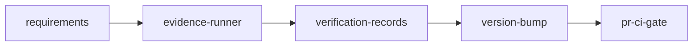

# Verification-refresh architecture blueprint (T855b)

Status: Built (docs-only architecture for the verification refresh; no product code)
Date: 2026-11-22
Worktree: /root/src/worktrees/auto-78, branch docs/verify-66-77-refresh, base b46fd81f (0.20.12)

## 1. What this blueprint bounds

The refresh rewrites GSD VERIFICATION records for phases 66-77 (incl. 66.2/66.3/66.4/74.1), creates any 77 SUMMARY the plan-count check finds missing, bumps 0.20.12 -> 0.20.13, and lands via a PR merged only on all-Green CI. It changes no product code, no schema DDL, no infrastructure. Every changed path sits under docs/ or .planning/.

Observed baseline verified by reads: VersionPrefix 0.20.12 (Directory.Build.props), CHANGELOG 0.20.12 dated 2026-11-21, global.json SDK 10.0.402, CI scripts/test-services.sh backed on Dragonfly. Observed VERIFICATION states at baseline: 66 gaps_found (4 gaps); 66.1 passed; 67 human_needed; 68 gaps_found; 69 human_needed; 70-76 gaps_found; 74.1 gaps_found; 77 gaps_found; 78 PASS. Commit a483dc90 added 77 and 78 SUMMARY/VERIFICATION files, so the tree already carries a SUMMARY for every 77 PLAN; downstream re-counts before writing.

## 2. C4 containers (refresh pipeline)

| Container | Owns | Relations (from -> to) |
|---|---|---|
| requirements | spec-T855b, acceptance, stories, traceability (A02) | -> evidence-runner |
| evidence-runner | targeted dotnet build/test, repo-checks, web smoke vs test-services (Dragonfly), SDK 10.0.402 | -> verification-records |
| verification-records | refreshed VERIFICATION.md + missing 77 SUMMARYs, covered_digest v1 sha256 | -> version-bump |
| version-bump | Directory.Build.props 0.20.13, CHANGELOG 0.20.13 section, STATE.md | -> pr-ci-gate |
| pr-ci-gate | PR to main, merge only on all-Green CI | (terminal) |

Product containers (src/, services/, apps/, docs/api/openapi.json) are read-only inputs to evidence-runner; the refresh writes no product file.

## 3. Layer order and fitness functions

layer_order (outer -> inner): docs-authoring -> evidence -> verification -> release. A module may depend on its own layer or any later one. Fan-out budget: 2.

Fitness functions (CI, blocking on main):
- arch_c4_fanout: containers above budget 2 or isolated containers fail the architecture review.
- arch_layer_violations: any edge pointing to an outer layer fails.
- arch_cycle_check: any dependency cycle fails.
- arch_contract_check on docs/api/openapi.json: breaking changes or missing operationId/responses fail.
- shared_verdict over all fitness findings: fail blocks further CLAIMED downstream tasks.
- arch_nfr_budget: measured NFRs vs budgets; unmeasured budgets fail closed.

## 4. NFR allocation

| NFR | Clause / budget | Checker | Status in design |
|---|---|---|---|
| NFR-P2 (perf): web smoke <= 600 s, 0 timeouts, SDK 10.0.402 | evidence-runner wall-clock budget 600 s | A08.load | allocated, measurement pending fresh run |
| NFR-S2 (security): gitleaks 0 findings, 0 secret literals in refreshed files | gitleaks on full diff | A10.sast | allocated |
| NFR-A2 (a11y): 0 axe errors, light+dark, 1440/1024/390 px | web smoke axe budget 0 | A08.a11y | allocated |
| NFR-I2 (i18n): 100% strings from English table, 0 hardcoded literals | lint budget 0 literals | A08.lint | allocated (docs-only: no new strings) |
| NFR-C2 (compliance): covered_digest v1 sha256, created date in window, commit on file, 0 stale digests | digest + date + commit clause | A10.compliance | allocated, non-negotiable, no gate may waive |

## 5. API contract (unchanged)

Contract: docs/api/openapi.json, openapi 3.1.1, info.version 1.1.0, 91 paths / 114 operations. arch_contract_check verdict pass, 0 breaking, 0 findings (run 2026-11-22). This refresh adds, removes and renames no path or operation; breaking_change false; info.version stays 1.1.0; arch_semver_bump none/none compliant. Consumers (A05/A06/A07/A08) stay pinned to the current digest. The earlier GAP-OP-1 note (80 missing operationId) is closed by the current file: every operation now carries an operationId.

## 6. Tech stack (approved catalog, nothing new)

- .NET SDK 10.0.402 (global.json pin) - no upgrade.
- CI backing: scripts/test-services.sh on Dragonfly.
- Repo checks and web smoke against test-services; no new test or a11y tooling.
- No novel infrastructure, no new first-party dependency: L2, no human-approval gate triggered.

## 7. Supply-chain and threat model

- SBOM: CI generates SBOM for the release image; docs-only diff adds no dependency.
- Dependency allowlist: PROJECT.md/STACK.md bar; Docker/Newtonsoft/FluentAssertions-8x stay prohibited (ADR-0001).
- Licence matrix: unchanged; AGPL/source-offer per ADR-0018.
- STRIDE: no new trust boundary is crossed (no new endpoint, no new store, no new actor). Existing boundaries (Supabase auth, tenant isolation, erasure) are untouched. A10 co-signs any future design that crosses a trust boundary.

## 8. Decision and consequences

Decision: docs-only verification refresh with fresh evidence per ROADMAP criteria, honest gaps_found with exact closing steps, human-only criteria kept in human_verification, version bump after evidence, PR merged only on all-Green CI. Phase 66 records its 4 gaps. Security-review-open items (e.g. 77 AG-77-10/11) stay open findings, not downgraded to pass.
Consequence: A05/A06/A07/A08 consume only the refreshed VERIFICATION files and the unchanged 1.1.0 contract; no integration surprise. Downstream evidence runs are the only remaining measurement risk, and they fail closed (unmeasured NFR = not within budget).

ADR-0002 records this decision (proposed -> accepted via arch_adr_transition).
