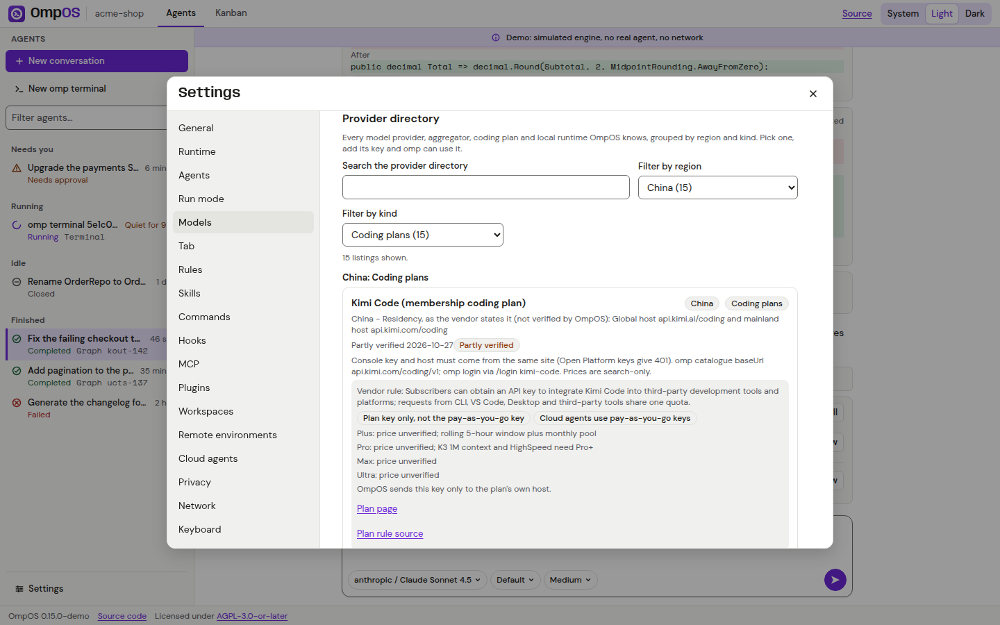

# Settings guide

Status: Partial (the desktop window has 21 pages plus Automations and all render on Linux without a model turn; the web dialog has 18 pages, several read-only or informational; no page has run against a live omp session with a model)

Last verified: 2026-10-28

Applies to: v0.15.0

Open Settings with Ctrl+, in the desktop app, or the Settings button in the web top bar (it opens a dialog). The desktop window is separate and non-modal. The row-by-row decisions against Cursor's settings are in [Settings parity](../settings-parity.md): 34 rows of the first window research plus the 50 rows S01 to S50 tracked by id (Built 6, Wired 2, Partial 20, Omitted 22). This page is the user's tour.

*Screenshot of the Demo build (simulated engine) in the web head: the real provider directory filtered to Chinese coding plans. Key entry is disabled in the Demo.*

*Screenshot of the real desktop app on Linux; the window overlaps the main window because the capture ran without a window manager. All 21 pages are in [the desktop evidence](../runbooks/evidence/desktop-app-2026-10-28/README.md).*

## Pages in the desktop window

Order in the window (`SettingsWindowFactory`): Runtime, General, Display, Agents, Run mode, Models, Tab, Rules, Skills, Commands, Hooks, MCP servers, Plugins, Workspaces, Worktrees, Ignore, Remote environments, Cloud agents, Automations, Privacy, Network, Keyboard. Display, Run mode, Models, Hooks, MCP servers, Workspaces, Remote environments and Automations appear only when the head supplies their service; the desktop app supplies all of them (Automations needs `omp` on the path to run local automations).

| Page | What you do there | Status |
|---|---|---|
| Runtime | Idle stop (default 24 hours, 1 to 720) and how long completed sessions are kept (default 7 days, 1 to 90). | Built |
| General | Theme (Light is the default; System and Dark), motion (follow system, reduce, full), a privacy statement, a link to About. | Built |
| Display | Vim keys in the composer, line numbers in code blocks, thinking blocks, status indicators, whether rewind works. Line numbers and status indicators take effect; the others are stored flags (S02, S09 in [Settings parity](../settings-parity.md)). | Partial |
| Agents | The terminal auto-run switch (off by default) and a note that every tool call follows omp's approval policy. | Built |
| Run mode | Auto-review, Allowlist or Run Everything, the read boundary and the allow and deny rules, applied to every session ([Run modes](../reference/run-modes.md)). | Partial (wired; no live turn) |
| Models | Providers, keys, default model, custom provider form, test connection and the 103-row catalogue by region and kind ([guide](providers-guide.md)). | Partial (no real credential used) |
| Tab | Read-only status of inline completion: on or off, the provider's host and port. | Built (read-only) |
| Rules, Skills, Commands | The rule files, skill files (including the ten built-in skills with scope Built-in) and slash commands of the workspace, read-only. | Built (read-only) |
| Hooks | The effective hooks and where they came from, approve or revoke a hook version, the run log ([Hooks](../reference/hooks.md)). | Partial (wired; no live omp) |
| MCP servers | Servers read from OmpOS, Cursor, Claude Code and VS Code files, their state and problems, and **Add from preset** (13 presets, added disabled) ([MCP servers](../reference/mcp.md)). | Partial |
| Plugins | The four plugins connected to every omp process, read-only. There is deliberately no switch. | Built (read-only) |
| Workspaces | Saved sets of several folders and starting a session in one ([Multi-repo](../runbooks/multi-repo.md)). | Partial |
| Worktrees | The worktree setup file and its consent state, read-only ([Checkpoints and worktrees](../reference/checkpoints-and-worktrees.md)). | Partial |
| Ignore | Cursor-style ignore files (gitignore syntax) that hide paths from the agent, Tab and `@` mentions. | Partial |
| Remote environments | Profiles for machines reached with your own `ssh`, containers (podman) and WSL distributions, preflight and diagnosis ([ssh](../runbooks/remote-ssh.md), [containers](../runbooks/remote-containers.md)). | Partial |
| Cloud agents | The cloud agent list and new-agent form; shows "not set up" without `OMPOS_API_BASE_URL` ([Cloud agents](../runbooks/cloud-agents.md)). | Partial (fakes only) |
| Automations | Scheduled prompts that start a session locally or a cloud agent; cron only on the desktop ([Automations](../reference/automations.md)). | Partial |
| Privacy | A statement of what OmpOS does and does not send. | Built |
| Network | A **Run diagnostics** button: one unauthenticated GET per known provider endpoint, only when pressed. | Built |
| Keyboard | The shortcuts the shell handles, grouped by scope. Remapping is not built. | Built (read-only) |

## Pages in the web dialog

Order (`WebSettingsOrder`): General, Runtime, Agents, Run mode, Models, Tab, Rules, Skills, Commands, Hooks, MCP, Plugins, Workspaces, Remote environments, Cloud agents, Privacy, Network, Keyboard.

| Page | What the web head does |
|---|---|
| General, Network, Keyboard | As on the desktop; General keeps theme and motion in the browser's local storage. |
| Runtime | Read-only values from `GET /settings/runtime`. |
| Models | The real provider directory over `GET /providers` with filters, plan cards with the rule tick box, URL-variable inputs and a write-only key field. The Demo disables key entry. |
| Rules, Skills, Commands, Plugins | Read-only lists from the API (`GET /workspace/conventions`, `GET /settings/plugins`; the commands page lists 95 entries). The API-hosted sessions carry no built-in skills. |
| Hooks | Read-only: hooks, hook files and problems from `GET /hooks`. Consent is not shown. |
| MCP | Read-only: the config files and diagnostics; no servers are started. |
| Tab, Agents, Run mode, Workspaces, Remote environments, Cloud agents, Privacy | An information page; most say the feature is in the desktop app. |

Display, Worktrees, Ignore and Automations have no web page. Test coverage: `WebSettingsPagesTests`, `SettingsRouteSurfaceTests`, `DemoProvidersRouteTests`, `DemoWorkspaceSettingsRouteTests`. Two sentences (the General page's "sends nothing anywhere itself" and the Network intro) are worded for the desktop and are not yet re-worded for the web.

## Settings Cursor has and OmpOS leaves out

OmpOS has no accounts, teams, billing, usage dashboard or hosted Cursor services, so those pages do not exist. Each omission has a reason recorded in [Settings parity](../settings-parity.md) (rows marked Omitted) and counted in the parity audit under OMITTED-BY-DECISION.

## Where settings are stored

| Setting | Stored in |
|---|---|
| Runtime, General, Agents, Display | A settings file under the state directory (`OMPOS_STATE_DIR`) |
| Run mode | `~/.ompos/run-mode.json` |
| Provider keys, custom providers | omp's credential database or `secrets/secrets.json`, and a marked block in omp's `models.yml` ([Choose a model provider](providers-guide.md)) |
| Web head settings | The browser's local storage for theme and motion; nothing for keys |
| Automations | `automations.json` and `automation-consent.json` in the desktop configuration directory |
