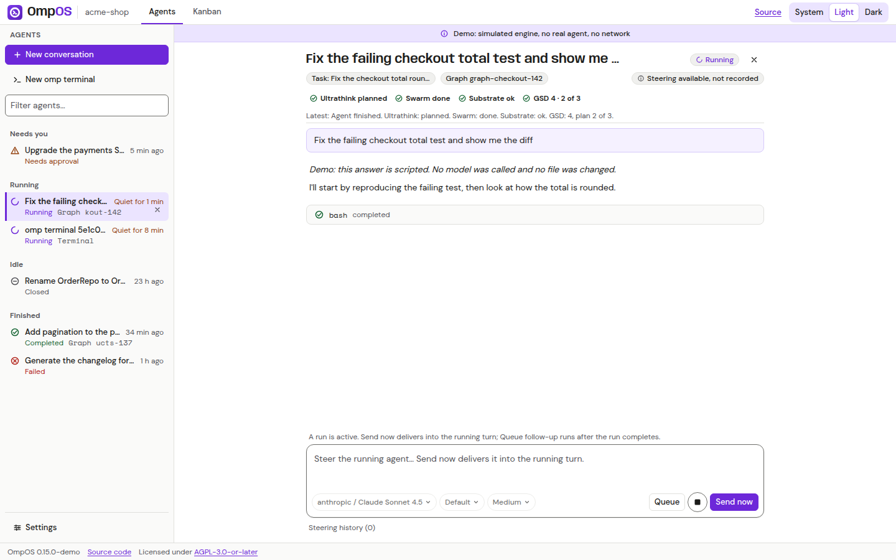
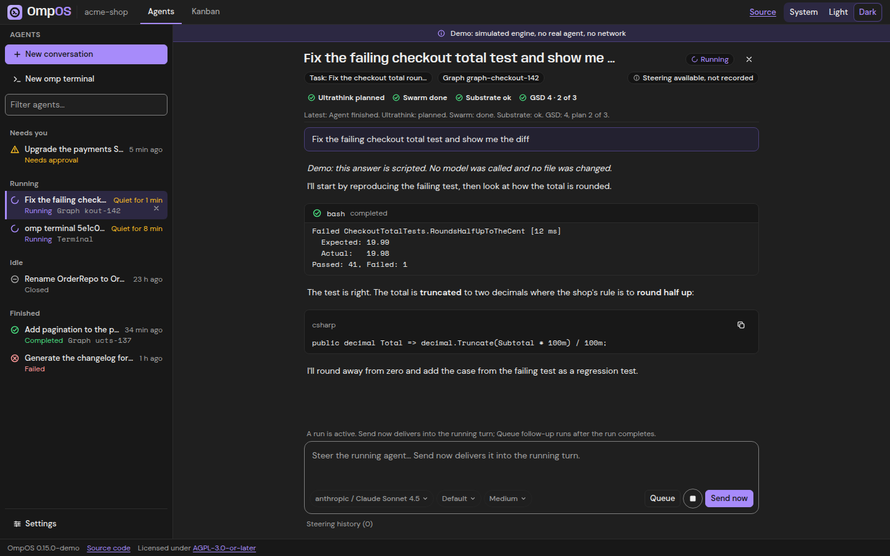
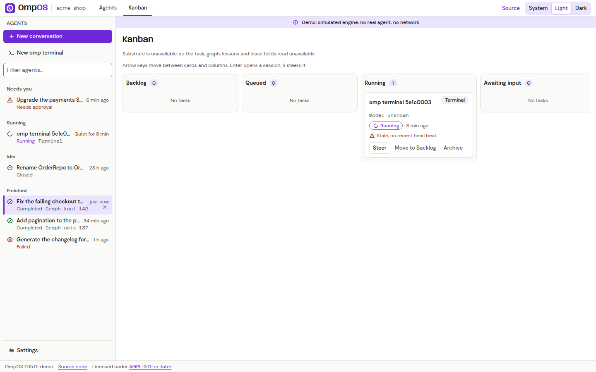
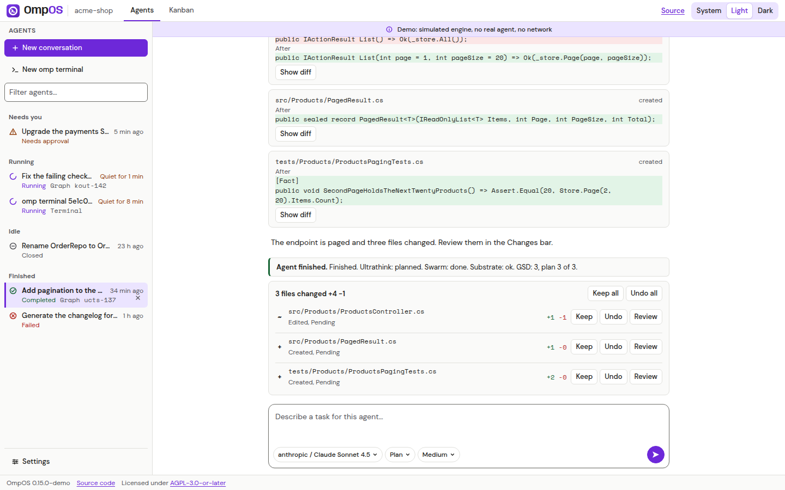
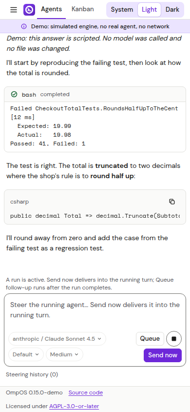

# Web app guide

Status: Partial (the components, the shell and the Demo are written with unit tests; the screens have not been run in a browser against this tree; no public deployment exists)

Last verified: 2026-10-28

Applies to: v0.15.0

The web head (`apps/OmpOS.Web`, Blazor WebAssembly) shows the same agent workspace as the desktop app in a browser, on the shared presentation layer and the White-and-Purple theme. It runs in one of two ways, and the page always tells you which.

| Way | What answers | Use it to |
|---|---|---|
| **Demo** | A scripted engine inside the browser (`-p:OmpOSDemo=true`). A banner says "Demo". | See the screens with no backend, model or key. |
| **Real API** | `services/OmpOS.Api`, over HTTPS and server-sent events. | Use a hosted or local API. With the in-memory harness it echoes; with a real harness it runs omp on the API host. |

How to start each: [Getting started](getting-started.md) and the [Web head runbook](../runbooks/web-demo.md).

*Screenshot of the Demo build: a simulated engine produces the thread.*

*Screenshot of the Demo build in the Dark theme.*

## Screens

| Screen | What it shows |
|---|---|
| Top bar | The product mark, the Agents and Kanban tabs, the theme switch (Light, Dark, System), the Settings button and the Demo banner when applicable. A skip link comes first in tab order. |
| Agent rail | The sessions with status glyphs, a New button and the Settings button. On a narrow screen it becomes a drawer. |
| Thread | The header (title, workspace, branch), a pipeline strip of stage events, plugin connection rows, the task context, then the transcript: markdown, code with a copy button, tool calls and results, plans and file edits with diffs. |
| Composer | The prompt box with model, mode and thinking chips, the slash palette (the commands the engine advertises; the Demo lists 20), steering while a turn runs and a history of steering messages. |
| Tool approvals | A list of pending approvals with Allow and Deny; the decision goes to the session. |
| Changes | A Changes bar and a review panel with Keep and Undo per file and a unified or split diff. With a real API and `Api:Workspace:Root` set, accepting or rejecting writes the file on the API host, and only when it still holds the text the agent wrote. |
| Kanban | The board with one card per session and ten columns, live status, steering from a card. |
| Settings dialog | The same pages as the desktop window, as far as the web head can back them: see the [Settings guide](settings-guide.md). |
| Terminal view | A terminal view for omp terminal sessions over a transport. The Demo answers with scripted output; a real API terminal needs a PTY on the API host and otherwise says so. |

*Screenshot of the Demo build.*

*Screenshot of the Demo build; in the Demo a decision is recorded only and no file exists.*

*Screenshot of the Demo build at a narrow width.*

## Demo versus a real API

The Demo workspace is called `acme-shop` and has six agents: one running (its answer streams as soon as the page opens), one waiting for a tool approval, one completed with three changed files, one failed with a retryable error, one closed and one omp terminal. Sending a prompt gets a scripted reply labelled "Demo". Honest limits:

- No model is called, no file exists and nothing leaves the page. The page's Content-Security-Policy allows only its own origin.
- Model values shown in the Demo are illustrative.
- Changing the model during a running turn is refused with the same 409 the API gives.

A normal build contains no Demo code; the runbook shows the check.

## Keys on the web

A provider key typed into the web head lives in page memory for one page session only. Closing or reloading the page loses it. See the [Web key threat model](../runbooks/web-key-threat-model.md) and [Choose a model provider](providers-guide.md).

## What the web head cannot do

- It starts no process: no omp, no local terminal, no `ssh`. Those run on the API host or in the desktop app. (The web head never references the process-spawning harness assemblies; an architecture test enforces it.)
- It cannot read your local files or run hooks, MCP servers, checkpoints or remote environments by itself. Those features are desktop (and API) features; the web head shows what the API exposes.
- It keeps no provider key beyond the page session.
- It has no offline mode other than the Demo.

## Accessibility and behaviour

The shell has landmarks and a skip link, a visible 2 px focus ring, 32 px targets and honours reduced motion. An axe-core check runs against the page in `./bootstrap.sh` (the web smoke); a full axe run of every new screen has not been recorded in this tree.

## The source offer

A footer link "Source code (AGPL-3.0-or-later)" appears on every screen, and the About page shows the version and revision, as the licence asks of a network service: [Licensing](../licensing.md).
